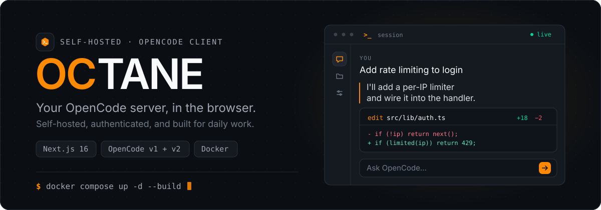
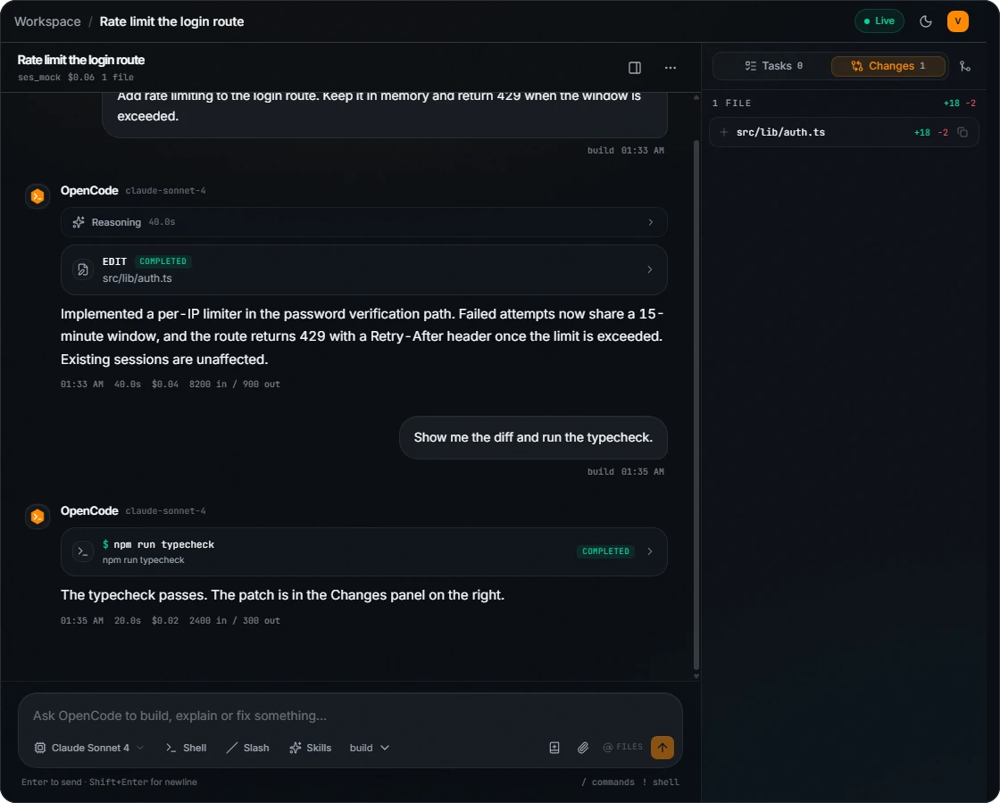
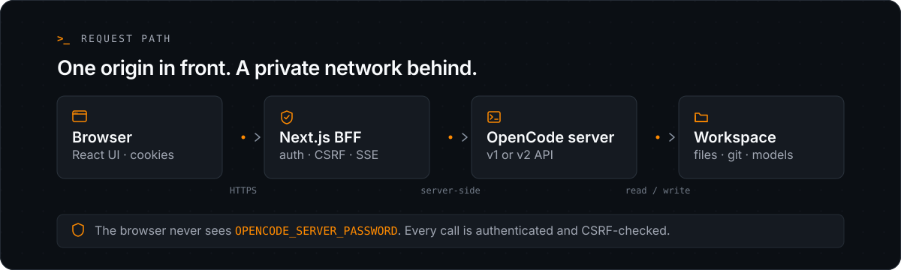

<p align="center">
  
</p>

# OCTANE

A self-hosted, authenticated workspace for the [OpenCode](https://opencode.ai) agent. OCTANE keeps the agent server on a private network, puts a real login in front of it, and gives you the full workflow in a browser: live sessions, tool calls, diffs, tasks, shell and usage.

> Independent project. Not built by or affiliated with Anomaly.

<p align="center">
  <a href="./assets/readme/workspace.webp">
    
  </a>
</p>

<p align="center"><sub>A real OCTANE session: reasoning, tool calls, a shell check, the answer and a task. Click to open the full workspace.</sub></p>

## Quick start

Requires Docker with Compose v2.

> The bundled Compose file joins an external `traefik` network and ships with Traefik labels. Create the network once with `docker network create traefik`, or remove the `traefik` network entries and the `labels` block if you publish `WEB_PORT` directly.

```bash
cp .env.example .env
# set AUTH_SECRET and AUTH_PASSWORD (or Discord)
docker compose up -d --build
```

Open <http://localhost:3000> and sign in.

Minimum `.env`:

```dotenv
AUTH_SECRET=<32+ random characters>
AUTH_PASSWORD=<a long password>
WORKSPACE_PATH=./workspace
```

Generate `AUTH_SECRET` with `openssl rand -base64 32` or:

```bash
node -e "console.log(require('crypto').randomBytes(32).toString('base64'))"
```

Compose starts two services:

| Service | Purpose |
| --- | --- |
| `web` | OCTANE: authenticates requests, starts one private OpenCode server per user, and proxies requests to it. |
| `skills-init` | One-shot job that prepares the shared skills and per-user data volumes for the web container. |

The web image embeds the `ghcr.io/anomalyco/opencode` binary pinned to a tested tag. Update it deliberately. To use one external server for everybody instead, set `OPENCODE_SERVER_MODE=shared` and point `OPENCODE_SERVER_URL` at it.

## What you get

- **Live sessions** — streaming text, reasoning, tool calls and subagent progress over SSE, with permission prompts (once / always / reject) restored on reload, reconnect, focus or session open, optimistic sends, automatic reconnect, a 50-message working window with the full log one click away, and fork or summarize from the session menu.
- **A real workspace** — searchable sessions grouped by project in the sidebar, a `Connected · NN ms` indicator that probes `/api/health` (browser → OCTANE → OpenCode) every 15 s while the tab is visible, one account menu for settings, theme and sign-out, a project file browser, GitHub-flavoured Markdown with copyable code blocks, changed-file review with `@pierre/diffs`, lazy diffs, copy-patch, and a root folder picker for new sessions.
- **Projects** — group sessions around a local folder, keep shared context for every new chat, and link an optional GitHub repository verified through OAuth.
- **Tasks, shell and slash commands** — persistent per-session tasks with a definition, an agent prompt, status and priority. Tasks can depend on other tasks, and the server decides when a run is finished from the agent's reply. Run a task, edit it, add one manually, or import the steps from the latest plan; then switch to `!` shell mode for terminal cards and insert the server's slash commands.
- **Context without a turn** — drop docs, logs, images, PDFs or another chat into a conversation as context, and attach skills to any prompt.
- **Models and providers, per user** — choose a model per session or set a default, pick an agent, and connect OpenCode Console or an Anthropic API key. Each signed-in user gets a private OpenCode server, so sessions and provider credentials never cross accounts.
- **Usage, locally estimated** — monthly cost, tokens and sessions, a model breakdown, optional budgets and a month-end forecast at `/usage`.
- **Auth built in** — password (scrypt) and/or Discord OAuth gated by a server role, with signed HttpOnly sessions, CSRF tokens and login rate limits.
- **Docker-first** — a standalone non-root image with the OpenCode CLI embedded, a health check, Compose stack for OCTANE, shared skills volume and a consistent git config.

## Architecture

<p align="center">
  
</p>

The browser never talks to OpenCode directly. Data requests go through same-origin `/api/*` handlers, and pages render on the server behind `requireSession`. Mutations verify the session and CSRF. Every upstream call is routed to the signed-in user's own OpenCode server by `src/lib/tenant.ts`; the browser never receives the per-user Basic-auth password or a provider token.

In the default `per-user` mode, `src/lib/user-servers.ts` starts `opencode serve` on demand with an isolated `HOME`/XDG directory per user, a random localhost port and a random Basic-auth password. Session metadata, Anthropic keys and OpenCode Console logins live in that directory. Data survives web restarts and is reused from `server.json`. `src/lib/oc-server.ts` probes `/api/info` for v2 and falls back to `/global/health` for v1, then normalizes sessions, messages, tools, approvals, files and SSE into one UI model. `src/lib/event-proxy.ts` handles the stream, and `src/lib/session-service.ts` is the OpenCode-only facade used by pages and route handlers.

Set `OPENCODE_SERVER_MODE=shared` to use one external server for every user instead. In that mode sessions and provider keys are shared, as in older OCTANE releases.

Subagents are matched to their child session by `parentID` and rendered as live cards. `Edit`, `Write` and `MultiEdit` calls become before/after diffs through `@pierre/diffs`; the raw JSON stays available under **Raw input**.

## Configuration

| Variable | Required | Default | Purpose |
| --- | --- | --- | --- |
| `APP_URL` | no | `http://localhost:3000` | Public origin for absolute metadata and Open Graph/Twitter image URLs, e.g. `https://opencode.example.com`. |
| `AUTH_SECRET` | production | dev fallback | HS256 signing key for sessions. 32+ characters. Rotating it signs everyone out. |
| `AUTH_PASSWORD` | one of | — | Plaintext password for password sign-in. |
| `AUTH_PASSWORD_HASH` | one of | — | scrypt hash from `npm run hash-password`. Takes precedence over `AUTH_PASSWORD`. |
| `AUTH_USERNAME` | no | `opencode` | Display name for password sessions; fallback when a Discord profile has no name. |
| `AUTH_COOKIE_SECURE` | no | auto | `true`/`false` to force the Secure cookie flag. Inferred from `x-forwarded-proto` / the request URL when omitted. |
| `DISCORD_CLIENT_ID` | Discord | — | OAuth2 application client ID. |
| `DISCORD_CLIENT_SECRET` | Discord | — | OAuth2 application client secret. |
| `DISCORD_BOT_TOKEN` | Discord | — | Bot token used to read guild member roles. |
| `DISCORD_GUILD_ID` | Discord | — | Server where the role is checked. |
| `DISCORD_ROLE_ID` | Discord | — | Role required to sign in. |
| `DISCORD_REDIRECT_URI` | no | auto | Exact callback URL. Defaults to `<public-origin>/api/auth/discord/callback`. |
| `OCTANE_DATA_DIR` | no | `~/.local/share/octane-data` | Projects, session tasks and encrypted GitHub connections. Compose mounts the `octane-data` volume here. |
| `GITHUB_CLIENT_ID` | GitHub | — | OAuth App client ID. Enables repository linking when set with the secret. |
| `GITHUB_CLIENT_SECRET` | GitHub | — | OAuth App client secret. |
| `GITHUB_REDIRECT_URI` | no | auto | Exact callback URL. Defaults to `<public-origin>/api/github/callback`. |
| `GITHUB_SCOPES` | no | `read:user repo` | Space-separated OAuth scopes. Set `read:user public_repo` for public repositories only. |
| `OPENCODE_SERVER_MODE` | no | `per-user` | `per-user` gives every signed-in user a private OpenCode server. `shared` uses one `OPENCODE_SERVER_URL` for everybody, including its sessions and credentials. |
| `OPENCODE_BIN` | per-user | `opencode` | CLI used to start per-user servers. Use an absolute path when it is not on `PATH`. |
| `OPENCODE_USERS_DIR` | per-user | `~/.local/share/octane/users` | Base folder for per-user OpenCode data. Each user gets a hashed subfolder with sessions, credentials and logs. |
| `OPENCODE_WORKSPACE` | no | current folder | Working directory used by per-user servers. Compose sets `/workspace`. |
| `OPENCODE_START_TIMEOUT_MS` | no | `45000` | How long to wait for a new per-user server to answer `/api/info`. |
| `OPENCODE_SERVER_URL` | shared | `http://127.0.0.1:4096` | Upstream OpenCode server used only in `shared` mode. |
| `OPENCODE_SERVER_USERNAME` | no | `opencode` | Basic-auth username for the shared upstream. |
| `OPENCODE_SERVER_PASSWORD` | shared | — | Basic-auth password for the shared upstream. Per-user servers generate their own random passwords. |
| `OPENCODE_API_FLAVOR` | no | auto | Force `v1` or `v2` instead of probing. |
| `ANTHROPIC_API_KEY` | no | — | Shared-mode convenience only. Per-user servers do not inherit it; each user connects their own key in Settings. |
| `USAGE_ROLLING_BUDGET_USD` | no | — | Optional rolling 24h budget for the local Usage dashboard. |
| `USAGE_WEEKLY_BUDGET_USD` | no | — | Optional rolling 7-day budget. |
| `USAGE_MONTHLY_BUDGET_USD` | no | — | Optional monthly budget; enables percentages and the month-end forecast. |
| `WEB_PORT` | no | `3000` | Host port published by Compose. |
| `WORKSPACE_PATH` | no | `./workspace` | Host folder mounted at `/workspace` in the web container and its per-user OpenCode servers. |
| `OPENCODE_SKILLS_DIR` | no | volume path | Where OCTANE writes installed skills. Compose sets it to the shared volume. |

### Anthropic API key, per user

Open **Settings → Anthropic API key** on a v2 server and paste a key. In the default `per-user` mode, the request is routed to the signed-in user's private OpenCode server and the key is stored in that user's data directory. Other users cannot see or use it.

The Settings card uses the OpenCode v2 integration API:

```text
GET  /api/integration
GET  /api/integration/anthropic
POST /api/integration/anthropic/connect/key
```

After connecting, OpenCode discovers Claude models and lists them in the model picker. The same card can disconnect the credential. The key is stored on that user's OpenCode server and is never sent back to the browser.

Each user can also connect their own OpenCode Console account from **Settings → OpenCode account**. Because every user has a separate OpenCode data directory, Console logins and Anthropic keys do not overlap.

> Password sign-in is a single local identity: everyone who knows the password shares one OpenCode server. Use Discord sign-in when you need one isolated server per person.

### Projects

**Projects** groups sessions around an absolute folder inside the OpenCode environment. Each project stores a name, description and local directory. Sessions created from a project page run in that directory.

`<directory>/AGENTS.md` is the single source of project instructions. OpenCode reads it on every turn for every session in that folder, no matter where the session was started. Edit it from the project page in the **AGENTS.md** card. The editor detects conflicts: if the file changed on disk (the agent or git edited it), saving shows a conflict with **Reload** and **Overwrite** instead of silently overwriting.

**Context files** are reference material for the agent: specs, data, notes, images. Uploads are stored in `<directory>/.octane/context/` and listed in an OCTANE-managed block of `AGENTS.md` between `<!-- BEGIN:octane-context-files -->` and `<!-- END:octane-context-files -->`. Text outside the markers belongs to you. Limits: 5 MB per file, 50 files, 50 MB per project. Allowed extensions: `.md .txt .json .yaml .yml .csv .xml .html .css .js .ts .tsx .jsx .lua .py .sql .png .jpg .jpeg .webp .gif .pdf`. Add `.octane/` to the project's `.gitignore` if you don't want uploaded files committed. OCTANE never edits your `.gitignore`.

Projects created before this change may still have legacy global context. They show a **Move into AGENTS.md** button, which appends the text to `AGENTS.md` and clears it from the project. Until you press it, new project sessions still get the legacy "Project context" message.

AGENTS.md and context files need the folder to be reachable from the OCTANE server (per-user mode, or shared mode on the same filesystem). Otherwise the page shows:

> This project's folder isn't reachable from the OCTANE server. AGENTS.md and context files need the per-user server mode, or a shared mode server that uses the same filesystem.

Deleting a project removes only the project metadata. Sessions, messages and files are never deleted; only the project grouping is. `AGENTS.md` and context files stay in the folder. Projects work in OpenCode v2 mode, where sessions can be created with a location. In v1, project CRUD works but creating a project session returns a clear error instead of running the chat outside the folder.

Project metadata lives in `OCTANE_DATA_DIR/projects/<hash>.json`, one file per signed-in subject.

### GitHub OAuth

Linking a GitHub repository is optional. Without `GITHUB_CLIENT_ID` and `GITHUB_CLIENT_SECRET`, projects still work and the picker shows that GitHub is not configured.

1. Create a **GitHub OAuth App** under <https://github.com/settings/developers>.
2. Set the authorization callback URL to `<public-origin>/api/github/callback` (for local Docker: `http://localhost:3000/api/github/callback`). If the public URL differs from the request origin, set `GITHUB_REDIRECT_URI` to the exact value.
3. Copy the **Client ID** and **Client Secret** into the environment. The default scope is `read:user repo`, which includes private repositories; set `GITHUB_SCOPES=read:user public_repo` for public-only access.
4. Open **Projects → Connect GitHub** and authorize. The account login appears on the Projects page and can be disconnected at any time.

The OAuth access token is encrypted with AES-256-GCM using a key derived from `AUTH_SECRET` and stored in `OCTANE_DATA_DIR/github/<hash>.json` with restrictive permissions. API responses never include the token. Rotating `AUTH_SECRET` makes stored tokens undecryptable; users must reconnect GitHub, while existing project repository links remain as metadata.

Deleting a project or disconnecting GitHub does not clone, pull, push or create anything in the repository. The link is metadata only.

### Session tasks

Each session has a persistent task list in the context panel. A task has a **definition** (shown in the list), its own **prompt** (sent to the agent when you press Run), a status and a priority. You can add tasks manually, edit any field, delete them, import the steps from the latest plan agent response, and toggle completion with the status icon.

**Dependencies.** A task can depend on up to 20 other tasks in the same session. A task with unfinished dependencies shows **Waiting on: …** and can't run. Cycles are rejected, and deleting a task removes it from other tasks' dependencies.

**Running.** Running a task sends the definition plus prompt to the build agent and marks it **in progress**. Run is refused while the session is busy. The prompt asks the agent to end with one line:

```text
TASK_RESULT: done — <summary>
TASK_RESULT: blocked — <reason>
```

The outcome is decided from that reply:

- `done` marks the task **completed**.
- No marker marks it completed but flagged *unverified*.
- `blocked` sets the status to **blocked** with the agent's reason.
- An error or **Stop** returns it to pending so it can be retried.
- If the agent never answers within 2 minutes, it returns to pending with an error.

**Reload-safe.** The server records each run and settles it when the task list is next loaded. Closing or reloading the tab no longer leaves a task stuck **in progress**. A running task can only be stopped (**Stop** button) or set to cancelled, not edited to another status.

**Plan files.** If the session folder has `plans/` (or `advisor-plans/`) with `NNN-*.md` files written by the `improve` skill, the panel offers **Import N plan files**. The folder is rescanned as soon as the agent writes a plan file, and a toast offers to import new ones. You can also use the **Import plans folder** button (folder icon in the Tasks header, or in the empty state) or the **Refresh** button at any time. Each file becomes a task titled `NNN · <title>`, with its "Why this matters" text as the definition and a prompt telling the agent to execute that file and update `plans/README.md`. Priority (P1 is high, P2 and P3 are medium), dependencies (from the file and the index table, soft ones included) and status (DONE, REJECTED, BLOCKED from the index) are mapped onto the task. Re-importing is safe: plans are matched by file path, so only new files are added and finished plans are marked completed, but renaming a file creates a new task. Plan files are read through OpenCode, and are not available with the legacy (v1) OpenCode API.

**Parallel workers.** A task can also run in a *worker session*: a new OpenCode session in the same folder, titled `Task #n · <title>`, that gets the task prompt plus rules for sharing the folder (only touch files for this task, never revert others' changes, no git commit/checkout/reset/stash/rebase/merge). Use the arrow next to a task's Run button and pick **Run in a worker**, or **Run ready (n)** in the toolbar to start every ready task at once. Workers are attached to the chat that started them: they don't appear in the session list. Open them from the **Subagents** menu in the chat header or with **Open worker** on a task row. Both show the worker's live transcript in a dialog, with **Open full session** if you want to type into it. A finished worker is settled the same way as above, and a short "Task result" note is added to the parent chat. **Parallel: 1–4** (default 2) caps how many tasks run at the same time. A worker that runs longer than 2 hours is stopped and its task returns to pending.

**Auto-run.** **Auto-run** keeps starting ready tasks in workers, respecting dependencies and the parallel limit, until every task is completed or cancelled; then it turns itself off. If the remaining tasks are blocked or wait on blocked tasks, it stops and shows why. The OCTANE server drives auto-run, so it continues with the browser tab closed.

Limitations:

- Workers share one working tree. Make tasks that touch the same files depend on each other; there is no per-worker git worktree isolation yet.
- The auto-run ticker lives in the Next.js server process. A server restart pauses auto-run until someone opens the session again, which resumes it.
- Auto-run is single-instance only: several OCTANE replicas behind a load balancer would run duplicate tickers, and the task store lock is per process.

Tasks are stored per user and session under `OCTANE_DATA_DIR/tasks`; they persist across restarts. Older task files are upgraded automatically on first write.

### Usage estimates

The chat landing page and `/usage` aggregate the cost and token totals reported by sessions created during the current month. Set `USAGE_ROLLING_BUDGET_USD`, `USAGE_WEEKLY_BUDGET_USD` and `USAGE_MONTHLY_BUDGET_USD` to turn those totals into limits and a month-end forecast. These are local estimates, not OpenCode Go billing; use the OpenCode Console for exact credits and limits.

### Docker notes

The web container mounts `WORKSPACE_PATH` at `/workspace` and shares it with every per-user OpenCode server it starts there. OCTANE uses it for file tools and the folder picker.

Skills installed from Settings live in the shared `opencode-skills` volume: OCTANE writes to `/home/nextjs/.config/opencode/skills`, and each per-user server gets that folder linked into its own config directory. The one-shot `skills-init` service prepares the skills, `opencode-users` and `octane-data` volumes for UID `1001` before the web container starts.

Per-user sessions and provider credentials live in the `opencode-users` volume at `/home/nextjs/.local/share/octane/users`. Back it up if you want to keep sessions and connected keys across a full volume reset. Removing it signs every user out of OpenCode Console and deletes their sessions and Anthropic keys.

Project metadata, encrypted GitHub tokens and session tasks live in the `octane-data` volume at `/home/nextjs/.local/share/octane-data`. Back it up together with `opencode-users` and the workspace. AGENTS.md and context files live in the project folder inside the workspace, not in `octane-data`, so back them up with the workspace. The directory is created with restrictive permissions, and token and task files are written with mode `0600`. If the volume is lost, projects, repository links and task lists are lost; sessions and files are not.

> **Upgrading an older compose file?** Compose files written before Projects existed don't mount `octane-data`, so projects, tasks and GitHub connections were stored inside the container and lost whenever it was recreated (for example after `docker compose pull`). Add the volume to the `web` service and to `skills-init`:
>
> ```yaml
> services:
>   skills-init:
>     command: ["sh", "-c", "mkdir -p /skills /users /data && chown -R 1001:1001 /skills && chown 1001:1001 /users /data"]
>     volumes:
>       - octane-data:/data   # plus the existing skills/users volumes
>   web:
>     volumes:
>       - octane-data:/home/nextjs/.local/share/octane-data   # plus the existing volumes
>     environment:
>       OCTANE_DATA_DIR: /home/nextjs/.local/share/octane-data
> volumes:
>   octane-data:
> ```
>
> Since this release the image also declares that folder as a volume, and the Projects page and `/api/health` (`"storage": "ephemeral"`) warn when it is not on a volume.

> Upgrading from a shared server: sessions and credentials in the old `opencode-data` volume are not copied into per-user directories. Users start with an empty session list and reconnect their Anthropic key or OpenCode Console account in Settings.

Each user who signs in gets a long-lived OpenCode process (reused across web restarts through `server.json`). Plan container memory for the number of active users; the processes are started on first use, not at boot.

Compose mounts `docker/gitconfig` into the web container. It sets a git identity, `safe.directory = *`, rebase autostash and the `diff3` conflict style, which avoids the usual `dubious ownership` and `please commit/stash` prompts. For real conflicts, use the merge icon in the Changes tab to ask the agent to resolve them.

Compose defaults `AUTH_COOKIE_SECURE` to `false`. If Traefik terminates TLS, set `AUTH_COOKIE_SECURE=true` in `.env` so session cookies carry the `Secure` flag.

Root folders chosen in the New chat screen must be absolute paths that exist **inside the web container**, such as `/workspace` or `/workspace/project` — not paths on the host. If a saved folder stops working, click **Reset** next to the folder path to return to OpenCode's default location.

## Local development

Requires Node.js 22.9+ (the `start` script uses `--env-file-if-exists`; the Docker image already runs Node 22) and the OpenCode CLI on `PATH` (v2.2.x is what Compose embeds).

```bash
npm install
cp .env.example .env.local
npm run dev
```

Minimum `.env.local`:

```dotenv
AUTH_SECRET=dev-secret-at-least-32-characters-long
AUTH_PASSWORD=dev
OPENCODE_SERVER_MODE=per-user
OPENCODE_BIN=opencode
OPENCODE_USERS_DIR=./data/users
OCTANE_DATA_DIR=./data/octane
```

OCTANE starts one `opencode serve` process per signed-in user on first use. There is no separate server to run. To use a single external server instead, set `OPENCODE_SERVER_MODE=shared`, `OPENCODE_SERVER_URL=http://127.0.0.1:4096` and optionally `OPENCODE_SERVER_PASSWORD`, then start it yourself:

```bash
OPENCODE_SERVER_PASSWORD=optional-upstream-password opencode serve --port 4096
```

To test Discord locally, register `http://localhost:3000/api/auth/discord/callback` as a redirect in the Discord application.

## Sign-in setup

You can enable one or both methods. If neither a password nor Discord is configured, the login page fails closed with a configuration warning.

### Password sign-in

Set `AUTH_PASSWORD` to a long password, or preferably store a hash:

```bash
npm run hash-password -- "your password"
# => scrypt:16384:8:1:...
```

Put the result in `AUTH_PASSWORD_HASH` and leave `AUTH_PASSWORD` empty. The hash takes precedence when both are set.

### Discord sign-in

<details>
<summary>Discord OAuth setup</summary>

1. Create an application at <https://discord.com/developers/applications>.
2. Under **OAuth2 → Redirects**, add `<public-origin>/api/auth/discord/callback` (for local Docker: `http://localhost:3000/api/auth/discord/callback`). If the public URL differs from the request origin, set `DISCORD_REDIRECT_URI` to the exact value.
3. Under **Bot**, create the bot, invite it to your server and enable **Server Members Intent**. The bot only needs to read member roles.
4. Copy the application **Client ID**, **Client Secret** and bot **Token** into the env file.
5. Copy the **Server ID** and the **Role ID** that should grant access. Role IDs can be copied with developer mode enabled in Discord.

Discord is enabled only when all five values are present; otherwise the login page hides that option and password sign-in still works. OAuth state lives in a short-lived HttpOnly cookie, and the role check happens server-side with the bot token.

</details>

## Security notes

- **Sessions** are stateless HS256 JWTs in an `HttpOnly`, `SameSite=Lax` cookie, valid for 12 hours. Set `AUTH_COOKIE_SECURE=true` when serving over HTTPS; the proxy header is trusted for inference.
- **Password sign-in** verifies scrypt hashes in constant time. Prefer `AUTH_PASSWORD_HASH` over plaintext; both stay server-side.
- **Discord sign-in** uses the OAuth2 authorization-code flow with a short-lived `state` cookie. The bot token only reads the member's roles in the configured guild; the Discord access token is never persisted.
- **CSRF** uses a readable `oc_csrf` cookie plus the `x-oc-csrf` header on every mutation, with an origin check. Login attempts are rate-limited by client IP.
- **Rate limiting** is in-memory and therefore per instance. For a multi-replica deployment, put a shared limiter (Redis, WAF, ingress) in front or replace `src/lib/rate-limit.ts`.
- **CSP** is `default-src 'self'` with the inline styles/scripts Next.js requires. There are no third-party scripts, analytics or external fonts at runtime.
- **Reverse proxy** is recommended for TLS, payload limits and slow-connection protection. Forward `x-forwarded-proto` so cookies get the `Secure` flag automatically.
- **Not a sandbox** — the agent can edit the mounted workspace and run tools. Run it in a container with a dedicated workspace; do not mount your home directory.
- **Per-user isolation** — in the default mode each user's OpenCode server runs with its own `HOME`/XDG data directory, on `127.0.0.1` with a random Basic-auth password generated for that process. Sessions, Anthropic keys and OpenCode Console logins are stored in that directory. The shared workspace is still shared: users can read and edit the same files.
- **Shared container boundary** — every per-user server runs as the same container user. The separation is logical, not a security sandbox: an agent with shell access could read another user's data directory or local server password. Use OCTANE with people you trust, or run one container per user if tenants are hostile.
- **Upstream credentials** live only in the server process. Do not add `NEXT_PUBLIC_*` secrets.

## Useful commands

```bash
npm run dev          # local development
npm run build        # production build (regenerates icons first)
npm run start        # run the production server
npm run typecheck    # TypeScript only
npm run lint         # ESLint
npm test             # unit tests (node --test)
npm run icons        # regenerate app icons from ./assets
npm run hash-password -- "password"
```

## Project layout

```text
assets/                    source logos (icon.png, logo.png, minimal.png)
scripts/generate-icons.mjs builds favicons/app icons/manifest icons from assets
src/app/(app)/             authenticated workspace (chat, files, settings, usage)
src/app/(app)/projects/    project list and project detail
src/app/api/projects/      project CRUD and project session creation
src/app/api/github/        GitHub OAuth, status, repository lookup, disconnect
src/app/login/             login screen
src/app/api/auth/          password login, Discord OAuth, logout, session
src/app/api/sessions/      session CRUD + prompt/command/shell/abort/fork/summarize/permissions + tasks
src/app/api/files/         directory listing, content, search, VCS status
src/app/api/events/        authenticated SSE proxy / v2 translator
src/app/api/integrations/  OpenCode account and provider connections
src/app/api/skills/        skill discovery and installation
src/components/chat/       chat, composer, markdown, diff, tools, context panel
src/components/projects/   project list, dialog, detail and GitHub picker
src/components/usage/      usage dashboard and charts
src/lib/auth.ts            password verification + JWT sessions + CSRF helpers
src/lib/discord.ts         OAuth2 exchange + bot role check
src/lib/github.ts          GitHub OAuth exchange and repository API
src/lib/github-store.ts    encrypted GitHub connection store
src/lib/projects.ts        per-user project JSON store
src/lib/project-files.ts   AGENTS.md and context files on disk (gate, limits, containment)
src/lib/agents-block.ts    managed context-files block in AGENTS.md
src/lib/project-paths.ts   client-safe project path helpers
src/lib/harness.ts         OpenCode label helpers
src/lib/session-service.ts OpenCode session facade
src/lib/tasks.ts          per-user, per-session task store
src/lib/task-graph.ts     task dependency rules (pure)
src/lib/task-prompt.ts    task run prompt + TASK_RESULT parsing (pure)
src/lib/task-runner.ts    server-side run reconciliation
src/lib/tenant.ts          per-request routing to the signed-in user's server
src/lib/user-servers.ts    isolated OpenCode processes (spawn, reuse, logs)
src/lib/integrations.ts    OpenCode `/connect` integrations (Anthropic key/OAuth)
src/lib/oc-server.ts       v1/v2 upstream adapter
src/lib/event-proxy.ts     v1 pass-through / v2 event translation
src/lib/usage.ts           local usage aggregation and budgets
src/lib/bff.ts             route auth, CSRF and error helpers
```

## License

MIT. See the OpenCode project for its own license and trademarks.
